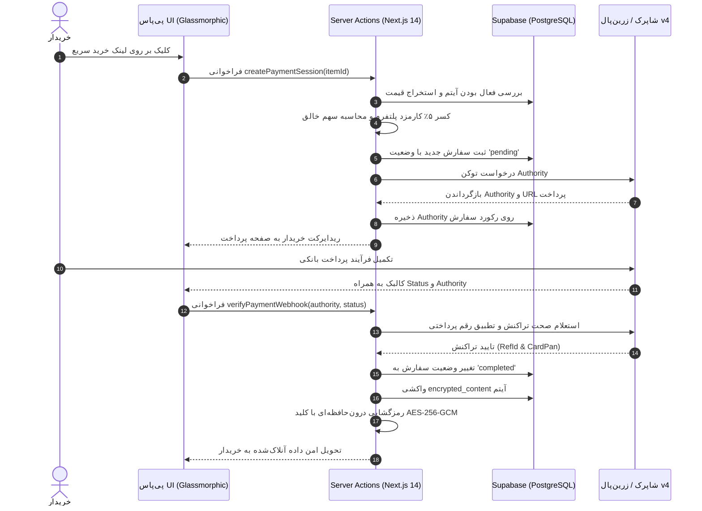

# جریان پرداخت و معماری امنیتی پی‌پاس (PayPass)
استودیو B2.st - نسخه پایدار Next.js 14 App Router

---

## ۱. چرخه حیات تراکنش (Transaction Lifecycle)

## ۲. منطق مالی ۵٪ کارمزد
* **قیمت آیتم:** $Amount$
* **کارمزد پلتفرم پی‌پاس (۵٪):** $\text{Fee} = \text{round}(Amount \times 0.05)$
* **سهم واریزی به خالق اثر:** $\text{Creator Amount} = Amount - \text{Fee}$

## ۳. حفاظت با رمزنگاری پیشرفته (AES-256-GCM)
کلیه محتواهای ارزشمند (لینک‌ها، توکن‌ها، متون راهنما یا فایل‌ها) پیش از ثبت در دیتابیس با کلید ۳۲ بایتی سالت‌شده رمزنگاری می‌شوند. داده در دیتابیس در قالب سه بخشِ `iv:authTag:encryptedPayload` نگهداری شده و حتی در صورت افشای پایگاه‌داده، بدون کلید سخت‌افزاری سرور قابل رمزگشایی نخواهد بود. محتوا صرفاً پس از تایید قطعی شاپرک رمزگشایی شده و به دست مشتری می‌رسد.